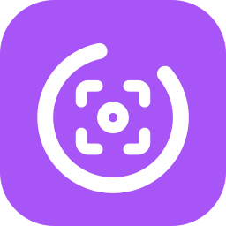
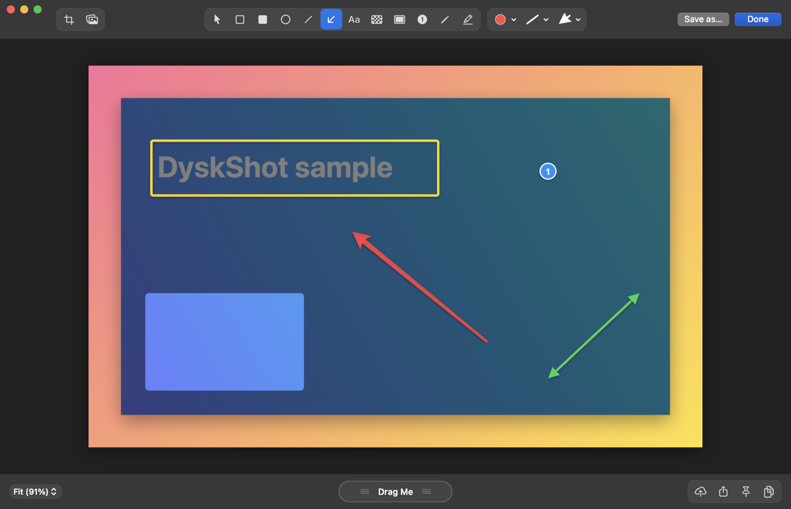
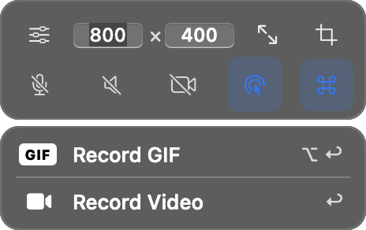
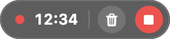
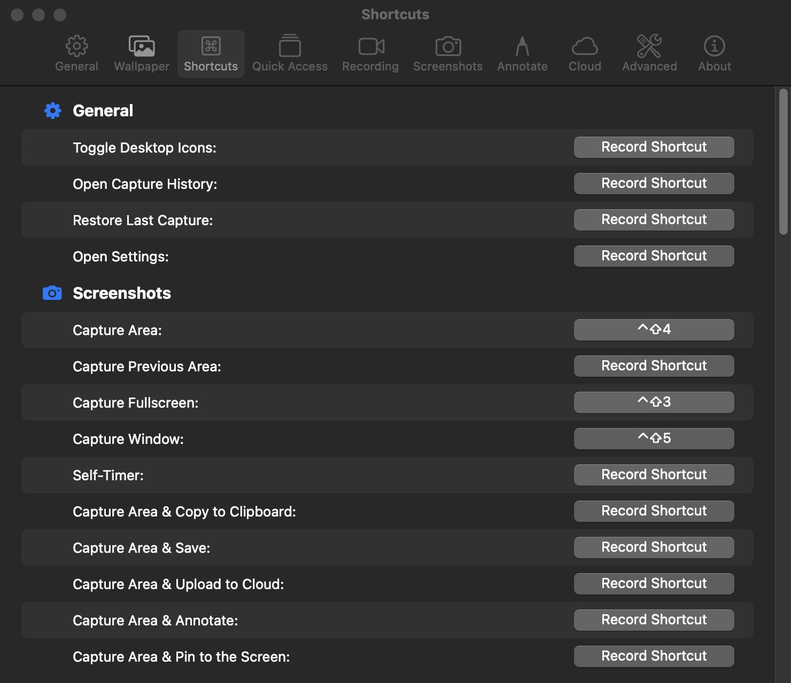
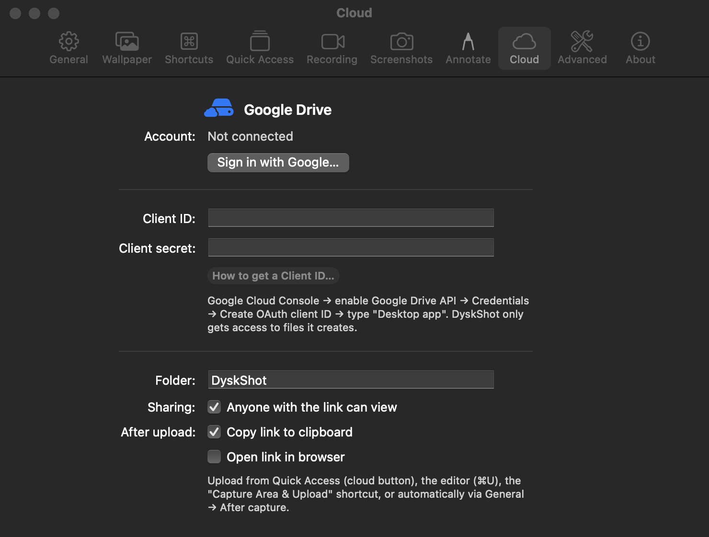

<p align="center">
  
</p>

<h1 align="center">DyskShot</h1>

<p align="center">A menu bar app for screenshots and screen recordings on macOS: capture, annotate, record, edit, compress, and share.</p>

<p align="center">
  <a href="https://dysklab.fanny.dev"></a>
  <a href="https://buymeacoffee.com/fannydevz"></a>
</p>



Press a shortcut, select an area, window, or screen, and the capture lands in a floating Quick Access thumbnail. From
there you can copy it, save it, annotate it, pin it, read its text, or upload it to Google Drive. Recordings work the
same way and can be trimmed, resized, compressed, or turned into GIFs.

- **Native and small.** Swift and AppKit on ScreenCaptureKit, with no Electron and no third-party dependencies. It builds
  with the Command Line Tools alone, so Xcode isn't required.
- **Private by default.** Everything stays on your Mac. Cloud upload is opt-in, uses your own Google OAuth client, and
  can only see files DyskShot creates.
- **Smaller files, same picture.** Compression re-encodes to HEVC at a visually lossless quality and passes the audio
  through untouched.

## Get it

**Requires:** macOS 15 or later and the Xcode Command Line Tools (`xcode-select --install`).

```bash
git clone git@github.com:DyskLab/dyskshot.git
cd dyskshot
./scripts/setup-signing.sh   # once: local signing identity so permissions survive rebuilds
./scripts/build-app.sh
open build/DyskShot.app
```

To install it, copy `build/DyskShot.app` to `/Applications`. After `git pull`, run `./scripts/build-app.sh` again.

> **macOS permissions:** the first capture asks for **Screen & System Audio Recording** (System Settings > Privacy &
> Security). Relaunch DyskShot after you allow it. System audio uses the same permission. The microphone, camera, and
> keystroke overlay (Accessibility) ask the first time you turn them on. If macOS keeps asking even though DyskShot is
> enabled, remove it from the list with **−** and enable it again.
>
> Without `setup-signing.sh` the app is signed ad hoc, and macOS forgets its permissions after every rebuild. To remove
> the identity, run `security delete-identity -c "DyskShot Local Signing"`.

## Features

- **Capture:** area, previous area, window (with wallpaper, padding, and shadow, or transparent), fullscreen, and
  self-timer. You can freeze the screen while selecting, with a crosshair and magnifier.
- **Quick Access overlay:** copy, save, annotate, pin, OCR, upload, and drag out to any app. It can close by itself.
- **Annotate:** crop, background presets, rectangle, filled rectangle, ellipse, line, arrow (four styles), text,
  pixelate, spotlight, counter, pencil, and highlighter, with undo and redo, zoom, and "Drag Me".
- **Text recognition (OCR):** copies the text from any area, with or without line breaks, in the languages Vision
  supports.
- **Pin to screen:** floating, always-on-top screenshots. Scroll to resize them.
- **Screen recording:** a resizable area with a W × H HUD, microphone and system audio, a camera bubble, click
  highlights, keystrokes, a countdown, and a dimmed background. It records to MP4 (H.264 or HEVC) or GIF.
- **Video editor:** trim with a filmstrip, then set quality, dimensions, and format, and choose an audio option (keep,
  mono, mute, or 0–200% volume).
- **Compress video:** HEVC at constant quality, with the same resolution, frame timing, and colour. The original is kept
  if the result wouldn't be smaller.
- **GIF:** frame rate 5–30, quality, merging of identical frames, and a maximum width.
- **Cloud:** uploads to a Google Drive folder and copies a shareable link.
- **History:** reopen recent screenshots, and choose how long to keep them.
- **Hide desktop icons:** covers desktop clutter while you capture, or until you toggle it back.

<p align="center">
  
  &nbsp;&nbsp;
  
</p>

## Shortcuts

Every action can have a global shortcut in **Settings > Shortcuts**. These are the defaults:

| Action | Key |
|---|---|
| Capture area | ⌃⇧4 |
| Capture window | ⌃⇧5 |
| Capture fullscreen | ⌃⇧3 |
| Capture text (OCR) | ⌃⇧2 |
| Record screen / stop | ⌃⇧6 |

While selecting, drag to pick an area. **Space** switches to window mode, **Shift** keeps it square, and **Esc** or a
right-click cancels. When you click a window, hold **Shift** to swap wallpaper and transparent, or **Option** to drop the
shadow. In the recording HUD, **↩** records video and **⌥↩** records a GIF.



## Google Drive



1. In [Google Cloud Console](https://console.cloud.google.com/apis/credentials), create a project, enable the **Google
   Drive API**, set up the **OAuth consent screen** (External, with yourself as a test user), and create an **OAuth
   client ID** of type **Desktop app**.
2. Paste the client ID and secret into **Settings > Cloud** and click **Sign in with Google…**.

Sign-in uses a loopback redirect with PKCE, and the refresh token is kept in the Keychain. DyskShot requests the
`drive.file` scope only, so it can't see any of your other files.

To upload, use the cloud button in Quick Access, **⌘U** in the editor, the **Capture Area & Upload to Cloud** shortcut,
or **After capture > Upload to Cloud**.

## Automation

Turn on **Settings > Advanced > API**, then run, for example, `open dyskshot://capture-area`. The commands are
`capture-area`, `capture-previous`, `capture-window`, `capture-fullscreen`, `self-timer`, `capture-text`,
`record-screen`, `record-gif`, `history`, `toggle-desktop-icons`, and `settings`. The `settings` command works even
when the API is off.

## Development

```
Sources/DyskShot/
  AppDelegate.swift        menu bar, URL scheme, main menu
  CaptureController.swift  capture flow, after-capture actions, permissions, desktop cover
  SelectionOverlay.swift   area/window/screen picker
  Capture.swift            ScreenCaptureKit capture, image ops, wallpaper, output
  QuickAccess.swift        floating thumbnails
  Editor.swift             annotate window      Annotation.swift  document, tools, renderer
  Recorder.swift           SCStream → AVAssetWriter, GIF encoder, recording controller
  RecordSetup.swift        area adjust, HUD, camera bubble
  VideoEditor.swift        export engine, compression, video editor window
  Cloud.swift              Google Drive OAuth + upload, Keychain
  PreferencesWindow.swift  settings panes       Prefs.swift  defaults
  HotKeyManager.swift      global shortcuts     OCR.swift, PinPanel.swift, History.swift, Toast.swift
  SelfTest.swift           in-app end-to-end test
```

- **Self-test:** `open -n --env DYSKSHOT_SELFTEST=/tmp/dyskshot-selftest/report.txt build/DyskShot.app` runs 46
  checks inside the real app, covering capture, encoding, annotation, OCR, overlays, settings, hotkeys, recording with
  system audio, GIF, the video editor, compression, the Keychain, and the OAuth loopback. Artifacts are written next to
  the report.
- **UI renders:** `open -n --env DYSKSHOT_RENDER_PREFS=/tmp/shots build/DyskShot.app` writes every settings pane, the
  editor, and the HUD as PNGs.
- **Icon:** `docs/icon.svg` follows the DyskLab icon style. Run `swift scripts/make-icon.swift` to regenerate
  `docs/icon.png` and `Resources/AppIcon.icns`.
